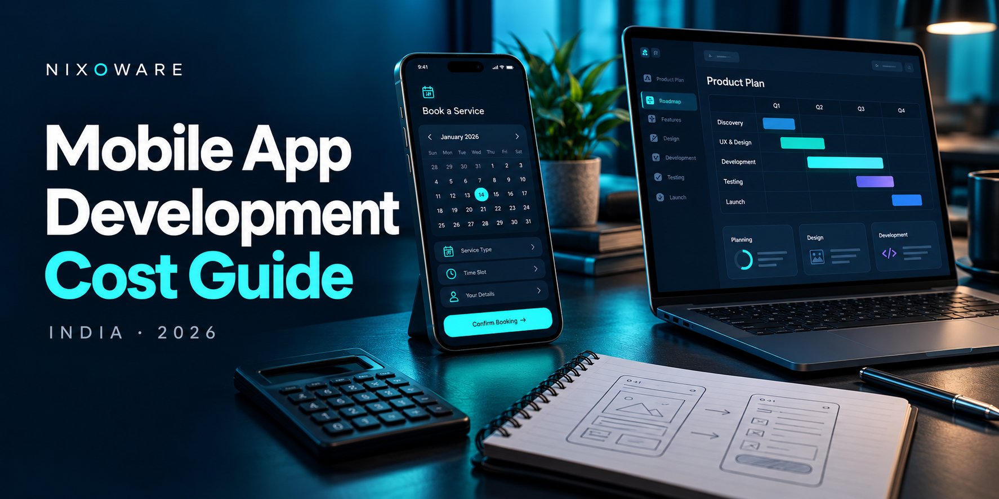

# How Much Does It Cost to Develop a Mobile App in India in 2026?

*A practical budgeting guide for Indian small businesses and international founders working with an Indian development team.*

**By Nixoware**

*Cover illustration created with AI for Nixoware.*

Imagine two businesses asking for a booking app.

The first wants customers to choose a service, request an appointment and receive confirmation. A staff member will manage the schedule.

The second wants customers to compare providers, book instantly, pay online, track a professional’s arrival and request refunds. Providers need their own accounts. The business needs to calculate commissions and resolve disputes.

Both describe the project as “a simple booking app.” Their budgets should reflect the very different work involved.

For an Indian small business spending carefully or an overseas founder funding a first product, the useful question is: **what is the smallest release worth paying for now?**

Answering that question makes an app budget easier to control. It helps you decide which capabilities earn their place in the first release and which can wait until customers demonstrate a need.

## An affordable starting point depends on what you need to prove

You do not have to commission a complete product to take the first useful step.

If you need to check whether customers understand an idea, a clickable prototype may be enough. If you need to find out whether a payment provider or existing business system can connect to your product, a focused technical investigation may answer that question.

A production MVP becomes appropriate when the learning depends on real accounts, bookings, orders or repeated use. It needs the supporting systems and quality checks required to handle those activities reliably.

Keeping these stages separate matters. Paying for a prototype can be sensible when it answers your current question. Treating it as a finished customer app creates a misleadingly low budget.

Nixoware’s current planning guide uses the following indicative bands:

- **Clickable prototype or technical proof of concept: ₹50,000–₹2 lakh.** A defined interaction or technical question, generally without a complete production system.
- **Focused MVP for one platform: ₹3–₹8 lakh.** One main customer journey, core design, essential backend functionality, testing and release preparation.
- **Cross-platform MVP for Android and iOS: ₹5–₹12 lakh.** A shared implementation where appropriate, with backend work, platform adjustments and testing for both platforms.
- **Business, booking or commerce app: ₹8–₹20 lakh.** Multiple customer journeys, payments or bookings, notifications, staff administration and integrations.
- **Marketplace or complex product: ₹15–₹40 lakh or more.** Several user roles, advanced workflows, more demanding security requirements and extensive testing.

These are planning estimates, not fixed Nixoware packages or measured market averages. A quote should explain its scope and identify taxes, hosting, provider fees and ongoing support separately. Category boundaries overlap, so the product’s name alone does not determine its price.

The [mobile app development cost guide](https://nixoware.com/blog/mobile-app-development-cost-guide) explains these bands in more detail. Use them to frame an initial discussion, then ask what can realistically fit your own budget.

## Budgeting for Indian and international customers

Affordability depends on the business paying for the product. A local retailer testing repeat orders may have different constraints from an overseas startup preparing a funded launch.

For an Indian business, make the total rupee commitment clear. Discuss the amount available for the first stage, what it should deliver and how much needs to remain available for operations after launch. If the budget cannot support the full scope, ask for a smaller workable release or a validation step.

For an international customer, request the same clarity in the agreed billing currency. Confirm how any currency conversion, payment fees and applicable taxes will be handled. A converted rupee estimate should not be mistaken for a fixed dollar quotation.

In both cases, compare the work included. A lower initial number is difficult to assess if design, testing, staff tools or release support are missing.

A phased proposal can make the commitment easier to manage. Define each stage’s deliverables, price and acceptance criteria, then agree payment milestones with the provider. This is a way to structure a discussion, not a promise of financing or a standard payment plan.

## Follow one booking through the business

Consider a local service business introducing appointment booking. This is an illustrative scope, not a client case study or quotation.

The customer needs to select a service and time. But the business also needs to decide who maintains availability, whether staff approve requests and what happens when someone cancels.

If online payment is included, the team must handle the case where payment succeeds but confirmation does not arrive. Staff need enough information to investigate. Customers need a clear status and a route to support.

Now compare two possible first releases.

In the smaller version, customers request appointments and staff confirm them manually. In the more automated version, the system allocates providers, checks availability and manages rescheduling automatically.

The smaller version may be appropriate for a pilot when staff can handle the workload. As bookings grow, manual work has a cost too. Automation becomes easier to evaluate once you know the volume and the problems it needs to solve.

**Describe both the customer task and the staff response before requesting a price.** That will produce a more useful estimate than a list of screens.

## What makes development more expensive?

A few decisions can materially change the work required.

**Additional user roles.** A customer, provider and administrator need different experiences and permissions. Each adds workflows to design and verify.

**Backend and staff tools.** Accounts, databases, APIs, file storage and an administration dashboard may be essential even when customers see only a few screens. Ask explicitly whether these are included.

**External integrations.** Payments, maps, messaging, inventory and accounting systems require configuration and testing. Available documentation, test accounts and access to existing systems affect the estimate.

**Offline or live behavior.** Saving a draft locally differs from synchronizing records that several people edit. Periodic status updates differ from live tracking. Describe the behavior you actually need.

**Design and assurance.** Research, prototypes, accessibility, security and testing take effort. Their depth should match the product and its risks. Removing necessary checks can move the expense into support and repair after launch.

For an India-facing app, Hindi and English content, UPI payments and usability on smaller devices may matter. For a product serving another market, language, payment methods and local operating requirements may differ. Include the needs of your actual audience in the brief.

## Android, iOS or both?

Start with evidence about the customers you need to reach. If a pilot serves a known group using Android devices, an Android-first release may be practical. If both platforms are necessary for your audience, account for both in the initial scope.

Flutter and React Native can share substantial implementation when Android and iOS experiences are similar. The team still needs platform configuration, permissions, device testing and store preparation. Some features also require native work.

Separate native applications may fit demanding device integrations or substantially different platform experiences. Team skills and future maintenance matter alongside the first development quote.

Ask providers to compare the same customer journeys, backend, integrations and release responsibilities. There is no dependable universal discount attached to a framework name. The useful saving is the effort your particular project can avoid without weakening the experience it needs to deliver.

## Reduce the first release without breaking its purpose

A minimum viable product should let people complete a valuable task and help the business decide what to build next.

For the booking example, the first question might be whether existing customers will use the app to request and manage appointments.

A focused release could include service selection, appointment requests, confirmation, booking history and a small staff dashboard. Loyalty points, chat and automated payouts could wait until usage demonstrates a need.

That approach gives a smaller budget a clear purpose. It also helps an overseas founder avoid funding features before learning how customers behave.

Define the evidence before launch. You might track completed bookings, repeat use, support requests and staff time per appointment. Downloads alone say little about whether the service improved.

Keep appropriate security, data handling, error recovery and testing within the release. When those basics cannot fit the available budget, reconsider the scope or validation method before proceeding.

## Keep money available after launch

The development invoice is one part of the commitment. A dependable budget also accounts for three ongoing areas.

**Infrastructure and provider charges:** hosting, storage, backups, messaging, maps, payment processing and monitoring. Ask which costs depend on usage and what assumptions support the estimate.

**Engineering support:** bug fixes, security updates, operating-system compatibility and investigation of production problems. Agree who responds, during which hours and what the support arrangement includes.

**Business operations:** customer enquiries, content updates, cancellations, staff training and product decisions. Some responsibilities remain with your organization even when an external team builds the app.

For international projects, agree on working-hour overlap, review schedules and support coverage before signing. Unclear availability can make an otherwise suitable engagement harder to operate.

Also confirm ownership of source code, app-store accounts, cloud accounts and business data. Clear ownership makes future maintenance and supplier changes easier to manage.

## Compare proposals using one shared brief

Prepare a short document covering:

1. The intended users and the problem they need to solve.
2. The complete journey required for the first release.
3. Required platforms, languages and device capabilities.
4. Staff tools, data sources and external integrations.
5. Quality, privacy, accessibility and security expectations.
6. Your available budget, launch constraints and ongoing responsibilities.

Mark unknowns openly. An uncertain integration may justify a small investigation before a fixed build price is agreed.

Then ask every provider three questions:

- **What assumptions would change this price?** Look for dependencies such as data quality, external access and unresolved workflow decisions.
- **How will we know a milestone is complete?** Expect working demonstrations and agreed acceptance criteria.
- **How are changes priced?** Understand how additional requirements affect both the fee and the delivery schedule.

Compare discovery, design, mobile development, backend work, administration, testing, deployment and support. Confirm billing currency and payment milestones where relevant. Choose based on the work you need and the total commitment you can sustain.

## Make the first investment useful

An affordable app project starts with a clear decision about what to build now. That principle works for an Indian business funding development from its own revenue and an international founder working with a team in India.

For a more detailed [breakdown of mobile app development costs in India](https://nixoware.com/blog/mobile-app-development-cost-guide), Nixoware’s guide covers features, platforms, timelines and maintenance. Use it alongside your requirements when discussing a phased estimate.

Before asking for the final price, write one sentence describing what a customer must be able to complete in the first release. Follow that task through the app, the staff workflow and the likely failure cases. That gives you a concrete basis for choosing a first investment your business can justify.
